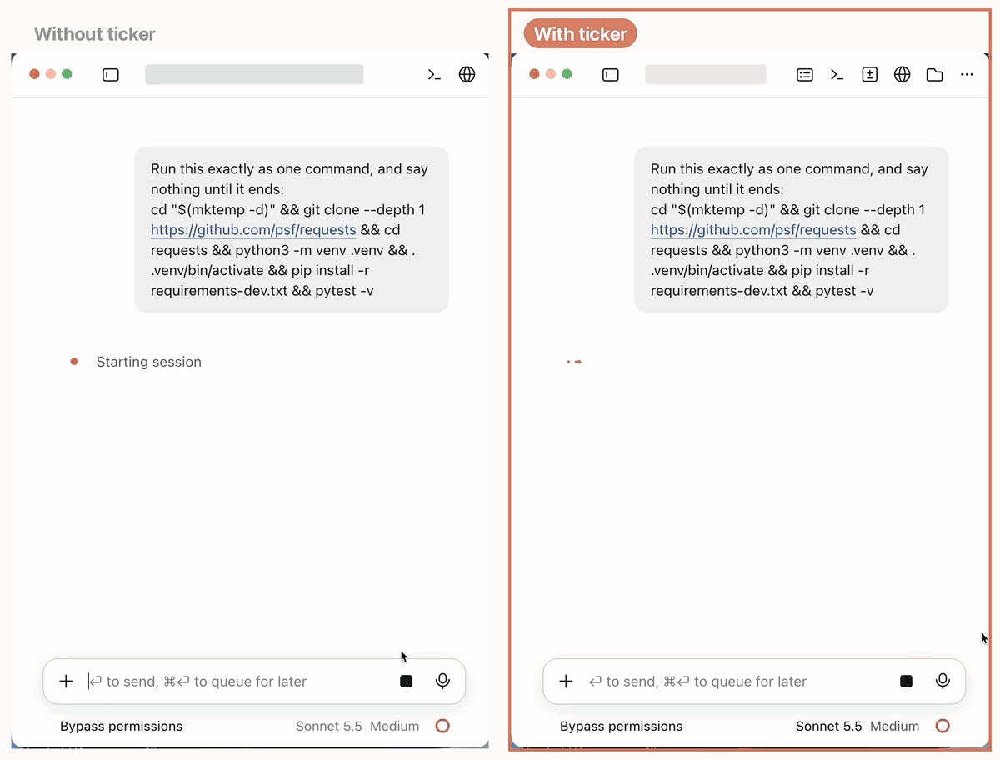

<div align="center">

# ticker

**See what a long command is doing, in plain words.**

A Claude Code mod for the desktop app. After 30 seconds, a running command gets one line that says where it is up to and what failed.

[](https://github.com/adamalshoomary/ticker/releases/latest)
[](LICENSE)

<a href="https://adamalshoomary.github.io/ticker/"></a>

</div>



<p align="center"><sub>Left: ticker. Right: no mod. <a href="docs/demo.mp4">Full run</a>.</sub></p>

## Install

**1. Paste this into Claude Code.** This is the easiest way.

```
Install the ticker mod from https://github.com/adamalshoomary/ticker.
```

**2. Or type this in a terminal session.**

```
/plugin install ticker --marketplace adamalshoomary/ticker
```

Answer `y` to add the marketplace, then press Enter for the user scope. The mod then loads in the desktop app's sessions too.

<details>
<summary>Other ways to install</summary>

**From a shell:**

```bash
claude plugin install ticker --marketplace adamalshoomary/ticker
```

**In the desktop app:** click **+** next to the prompt box, then **Plugins**, then **Add marketplace**. Type `adamalshoomary/ticker`, then click **Add plugin**.

</details>

## Use

Nothing to do. When a Bash command runs for 30 seconds, a line shows under the command and updates as it runs. The spinner keeps Claude Code's own words. A subagent's command shows its line above the prompt. The line goes away when the command ends.

| Command | Line at 30 to 50 seconds |
|---|---|
| Python unittest, 36 tests | Rotate image test failed; running the rest of the unit suite |
| `make`, 31 C files | Compiling the C program, now on the mod14 source file |
| `make 2>&1 \| wc -l` | Building the C program; results show when it finishes |

The mod's own rules count tests, files and steps. Haiku turns the counts and the newest 25 lines into a sentence. A sentence with a number the rules did not count is refused, and the rules line shows in its place.

**One setting**, `summaries`: `haiku` (the default) or `rules`, which calls no model. Set it on the install screen, or in `/config` in a terminal session.

## Updates

The mod checks GitHub for a new version once a day. When one is out, a line above the prompt shows **Update** and **Later**, and a pop-up says so once. Update installs it, and your next chat uses it. Nothing installs without the click.

On 1.0.0, which has no check, update once by hand: `claude plugin update ticker@ticker` in a shell, or **+**, then **Plugins**, in the desktop app.

## Cost and privacy

- Haiku is asked at 30 seconds, then every 20 seconds while the command prints and every 60 seconds while it is quiet. 30 calls per command at most.
- Each call goes through your own login. On a Pro or Max plan it counts against your limits. With an API key it costs about $0.0001.
- Each call sends the command, its description and the newest 25 lines. Text that looks like a key, token or password is masked first. If a command prints secrets, use `rules`.
- The update check reads the mod's `plugin.json` from GitHub once a day. It sends nothing about you or your work.

## Limits

- The mod reads an output file that Claude Code writes for each command. The file is undocumented, so an update can blank the line. Commands still run as before.
- Background commands get no line yet. Neither does a command that ends within 30 seconds.
- A command that pipes into `tail`, `grep` or `sort` shows little until it ends. The line says so.
- Another mod that redraws a command's row can hide the line.
- Tested on Claude Code 2.1.308 in the desktop app on macOS. Linux and Windows are untested.

<details>
<summary>How it works</summary>

1. When Claude starts a Bash command, the mod notes the command, its description and the time.
2. Every 5 seconds, it finds the command's output file with `lsof` and `ps` and reads the new bytes.
3. Rules for Python, pytest, Go, cargo, jest, C compilers, make, ninja, cmake, Gradle, tsc, npm and pip count results. For other tools, the rules line is the last printed line.
4. At 30 seconds, the rules line shows. If the app drew it, Haiku writes a sentence, with low effort and an 8-second limit.
5. Each number in the sentence is checked against the counts. When the command ends, the line is removed.

To check the mod, run `claude plugin validate .` and `claude plugin test .` in this folder.

</details>

## For agents

If a user asks you to install ticker from this page, follow these steps.

1. Run `claude plugin install ticker --marketplace adamalshoomary/ticker`.
2. Tell the user to start a new session in the desktop app or terminal.
3. Tell them the line shows after a command runs for 30 seconds.

## Licence

MIT. See [LICENSE](LICENSE).
